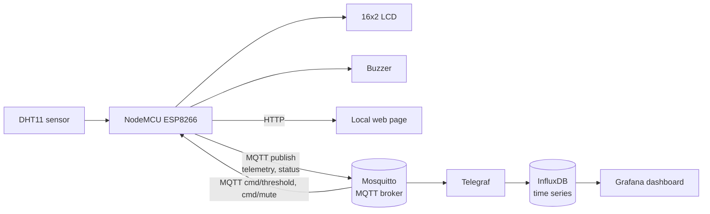

# Smart Room Temperature Monitor

An IoT system that measures room temperature and humidity using a DHT11 sensor. The NodeMCU ESP8266 displays the readings on an LCD, serves a local web page, and publishes every reading over MQTT. A data pipeline (Mosquitto, Telegraf, InfluxDB) stores the history, and Grafana shows it on a live dashboard. A buzzer alerts the user when the temperature reaches the alert threshold, and the threshold and buzzer can be controlled remotely over MQTT.

## Architecture



Everything to the right of the NodeMCU runs in Docker on a laptop (or Raspberry Pi) on the same Wi-Fi network (see `server/`).


## Components

- NodeMCU ESP8266
- DHT11 temperature and humidity sensor
- 16x2 LCD with I2C backpack
- Buzzer
- Breadboard and jumper wires
- USB data cable
- Wi-Fi network
- A computer with Docker Desktop on the same network (runs the MQTT broker, database, and Grafana)

## Wiring

### DHT11 Sensor

| DHT11 Pin | NodeMCU Pin |
|---|---|
| Signal | D5 |
| VCC | 3V3 |
| GND | GND |

### LCD I2C Backpack

| LCD Pin | NodeMCU Pin |
|---|---|
| GND | GND |
| VCC | 3V3 |
| SDA | D2 |
| SCL | D1 |

### Buzzer

| Buzzer Pin | NodeMCU Pin |
|---|---|
| Positive (+) | D6 |
| Negative (-) | GND |

## Software

- Arduino IDE
- ESP8266 board package
- DHT sensor library by Adafruit
- Adafruit Unified Sensor library
- LiquidCrystal I2C library
- PubSubClient library by Nick O'Leary (MQTT client)
- Docker Desktop (for the server stack in `server/`)
- Python 3 with `paho-mqtt` (optional, only for the sensor simulator)

## Wi-Fi and MQTT Configuration

Before uploading the sketch, replace the placeholders with the Wi-Fi network information and the IP address of the computer running the server stack:

```cpp
const char* ssid = "YOUR_WIFI_NAME";
const char* password = "YOUR_WIFI_PASSWORD";

const char* MQTT_HOST = "YOUR_COMPUTER_IP";  // e.g. 10.0.0.25
const char* DEVICE_ID = "room1";
```

On macOS, find the computer's IP address with `ipconfig getifaddr en0`. The NodeMCU and the computer must be on the same Wi-Fi network. If macOS asks whether Docker may accept incoming connections, allow it.

Do not upload real Wi-Fi credentials to a public GitHub repository.

## Temperature Alert

The default alert threshold is 30°C:

```cpp
float alertTemp = 30.0;
```

When the temperature reaches or exceeds this value, the LCD displays a high-temperature warning and the buzzer sounds. The web page and the Grafana dashboard also report the alert. The threshold can be changed and the buzzer muted at runtime over MQTT (see [MQTT Topics](#mqtt-topics)).

## Running the Project

### 1. Start the server stack

```bash
cd server
docker compose up -d
```

| Service | Address | Login |
|---|---|---|
| Grafana dashboard | http://localhost:3000 | Opens read-only; `admin` / `admin` to edit |
| InfluxDB | http://localhost:8086 | `admin` / `smartroom-admin` |
| MQTT broker | `localhost:1883` | none |

These credentials are for a local class demo only. Stop the stack with `docker compose down` (add `-v` to also delete the stored data).

### 2. Upload the firmware

1. Connect the NodeMCU to the computer with a USB data cable.
2. Open the sketch in Arduino IDE.
3. Select **NodeMCU 1.0 (ESP-12E Module)** as the board.
4. Select the NodeMCU serial port.
5. Upload the sketch.
6. Open Serial Monitor at **115200 baud**.
7. Wait for the NodeMCU to connect to Wi-Fi.
8. Copy the IP address shown in Serial Monitor.
9. Open that IP address in a web browser to see the local web page.
10. Open Grafana at http://localhost:3000 and pick the device (`room1`) from the **Device** menu.

Example:

```text
http://10.0.0.118
```

The local web page refreshes automatically every three seconds. The Grafana dashboard refreshes every five seconds.

## MQTT Topics

`<id>` is the `DEVICE_ID` set in the sketch.

| Topic | Direction | Payload |
|---|---|---|
| `smartroom/<id>/telemetry` | device → broker | JSON reading every 2 s (see below) |
| `smartroom/<id>/status` | device → broker | `online` / `offline` (retained; `offline` is the MQTT Last Will, sent by the broker if the device disconnects unexpectedly) |
| `smartroom/<id>/cmd/threshold` | broker → device | New alert threshold in °C, e.g. `28.5` |
| `smartroom/<id>/cmd/mute` | broker → device | `1` / `0` (also `true`/`false`, `on`/`off`) |

Example telemetry message:

```json
{"temperature":24.0,"humidity":45.0,"heat_index":23.8,"threshold":30.0,"alert":0,"buzzer_muted":0,"sensor_errors":0,"rssi":-58,"uptime_s":312}
```

Send commands from any computer on the network, for example with the Mosquitto clients (`brew install mosquitto`):

```bash
mosquitto_pub -h <computer-ip> -t smartroom/room1/cmd/threshold -m 28
mosquitto_pub -h <computer-ip> -t smartroom/room1/cmd/mute -m 1
mosquitto_sub -h <computer-ip> -t 'smartroom/#' -v
```

Commands are not saved on the device, so it returns to 30°C after a reboot. Add `-r` to `mosquitto_pub` to make the broker keep the command and resend it every time the device reconnects.

## System Behavior

- The LCD displays the current temperature and humidity.
- The NodeMCU serves the current readings on a local web page.
- The NodeMCU publishes each reading, including the heat index ("feels like" temperature), over MQTT.
- Telegraf stores the readings in InfluxDB, and Grafana charts the history.
- The buzzer sounds during a high-temperature alert unless it has been muted over MQTT.
- The buzzer stops when the temperature returns below the threshold.
- If the DHT11 read fails, the LCD and web page report a sensor error, and the failure count is included in the next telemetry message.
- If the MQTT broker is unreachable, the LCD, buzzer, and web page keep working, and the NodeMCU retries the connection every 5 seconds.

## Testing

To test the alert without waiting for a hot room, lower the threshold below the current room temperature over MQTT, then set it back:

```bash
mosquitto_pub -h <computer-ip> -t smartroom/room1/cmd/threshold -m 20
mosquitto_pub -h <computer-ip> -t smartroom/room1/cmd/threshold -m 30
```

### Testing without the hardware

`tools/simulate_sensor.py` acts like a NodeMCU: it publishes the same topics and JSON, sets the same Last Will, and obeys the same commands. Use it to test the server stack or record a backup demo.

```bash
pip install -r tools/requirements.txt
python tools/simulate_sensor.py --device sim1                 # normal room
python tools/simulate_sensor.py --device sim1 --heatwave 120  # warms 9°C over 2 minutes, triggers the alert
```

Then pick `sim1` from the **Device** menu in Grafana.

## Project Files

- `smart_room_temperature_monitor.ino` - Arduino source code for the NodeMCU: sensor, LCD, buzzer, Wi-Fi, local web page, and MQTT client.
- `server/docker-compose.yml` - Mosquitto, Telegraf, InfluxDB, and Grafana.
- `server/mosquitto/mosquitto.conf` - MQTT broker settings.
- `server/telegraf/telegraf.conf` - Subscribes to the MQTT topics and writes to InfluxDB.
- `server/grafana/` - Preconfigured InfluxDB data source and the Smart Room Monitor dashboard.
- `tools/simulate_sensor.py` - Simulated device for testing without hardware.
