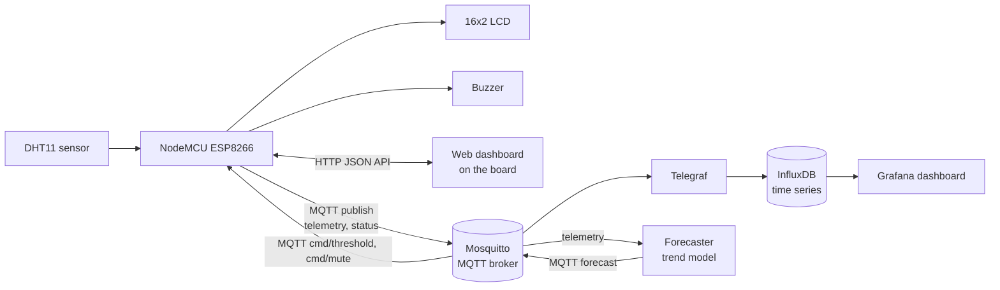
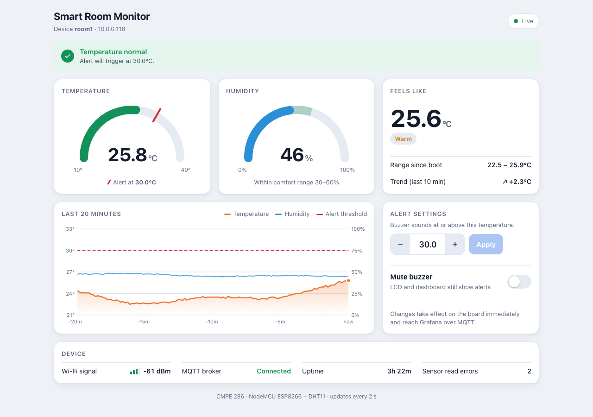
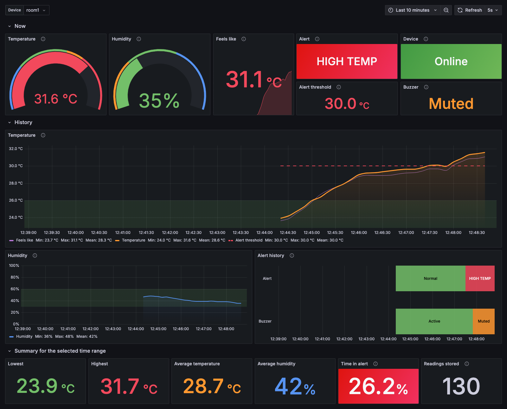
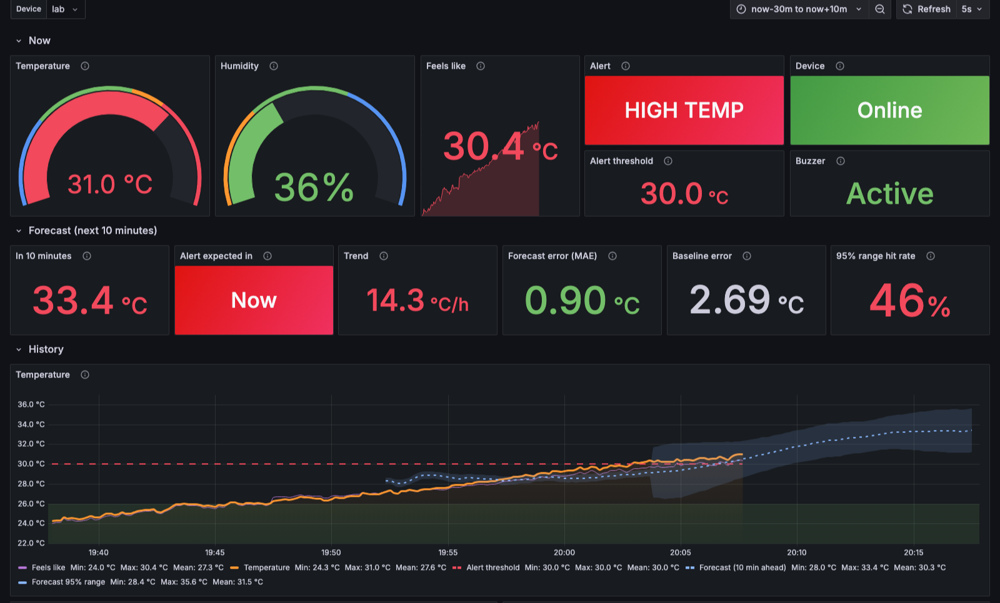

# Smart Room Temperature Monitor

An IoT system that measures room temperature and humidity using a DHT11 sensor. The NodeMCU ESP8266 displays the readings on an LCD, serves its own live web dashboard, and publishes every reading over MQTT. A data pipeline (Mosquitto, Telegraf, InfluxDB) stores the history, and Grafana shows it on a live dashboard. A buzzer alerts the user when the temperature reaches the alert threshold, and the threshold and buzzer can be controlled from the web dashboard or remotely over MQTT.

## Architecture



Everything to the right of the NodeMCU runs in Docker on a laptop (or Raspberry Pi) on the same Wi-Fi network (see `server/`). A detailed version with the measured latencies is in [docs/data-flow.png](docs/data-flow.png) ([SVG](docs/data-flow.svg)).

## Dashboards

**Web dashboard on the NodeMCU** (open the board's IP address in any browser on the same network; no laptop or internet needed):



**Grafana dashboard** (history, alerts, and summary statistics from InfluxDB; screenshot uses simulated data):



**Forecast panels** during a simulated heat event: the dashed line and band are the 10-minute-ahead forecast and its 95 % range, drawn ahead of the measured temperature (see [Temperature Forecast](#temperature-forecast)):



## Report and Presentation

- **Report** (IEEE conference format): [docs/report/report.pdf](docs/report/report.pdf), source [report.tex](docs/report/report.tex). Build it with `cd docs/report && latexmk -pdf report.tex`. The red `[...]` placeholders (university, emails, hardware validation, acknowledgment) still need to be filled in by the team.
- **Slides** (3 minutes, 7 slides, script in the speaker notes): [docs/presentation/smart-room-presentation.pptx](docs/presentation/smart-room-presentation.pptx)
- **Presentation script** with timings for each slide: [docs/presentation/script.md](docs/presentation/script.md)

Results so far, all measured on the server stack and with simulated sensor data (the hardware measurements are still to be done):

| What | Result |
|---|---|
| Firmware tests on a computer (fake hardware) | 26 tests, plus 14 forecast-model tests; found 2 defects |
| End-to-end test of the running stack | 51 of 51 checks pass; found a third defect (forecasts after a device restart) |
| Board frozen while the broker is unreachable | 99 % of the time before the fix, 11 % after |
| MQTT broker hop, publish to stored in InfluxDB | 1.7 ms and 4.6 s (medians) |
| Device shown offline | 0.01 s after a reset, 24 s after a silent power loss |
| ESP8266 build | 39 % of RAM, 29 % of flash |
| Forecast, 10 minutes ahead, simulated heat event | alert announced 16–18 min early; error 0.9 °C vs 2.7 °C for "same as now" |

## Components

- NodeMCU ESP8266
- DHT11 temperature and humidity sensor
- 16x2 LCD with I2C backpack
- Buzzer
- Breadboard and jumper wires
- USB data cable
- Wi-Fi network
- A computer with Docker Desktop on the same network (runs the MQTT broker, database, and Grafana)

## Wiring

### DHT11 Sensor

| DHT11 Pin | NodeMCU Pin |
|---|---|
| Signal | D5 |
| VCC | 3V3 |
| GND | GND |

### LCD I2C Backpack

| LCD Pin | NodeMCU Pin |
|---|---|
| GND | GND |
| VCC | 3V3 |
| SDA | D2 |
| SCL | D1 |

### Buzzer

| Buzzer Pin | NodeMCU Pin |
|---|---|
| Positive (+) | D6 |
| Negative (-) | GND |

## Software

- Arduino IDE
- ESP8266 board package
- DHT sensor library by Adafruit
- Adafruit Unified Sensor library
- LiquidCrystal I2C library
- PubSubClient library by Nick O'Leary (MQTT client)
- Docker Desktop (for the server stack in `server/`)
- Python 3 with `paho-mqtt` (optional, only for the sensor simulator)

## Wi-Fi and MQTT Configuration

Before uploading the sketch, replace the placeholders with the Wi-Fi network information and the IP address of the computer running the server stack:

```cpp
const char* ssid = "YOUR_WIFI_NAME";
const char* password = "YOUR_WIFI_PASSWORD";

const char* MQTT_HOST = "YOUR_COMPUTER_IP";  // e.g. 10.0.0.25
const char* DEVICE_ID = "room1";
```

On macOS, find the computer's IP address with `ipconfig getifaddr en0`. The NodeMCU and the computer must be on the same Wi-Fi network. If macOS asks whether Docker may accept incoming connections, allow it.

Do not upload real Wi-Fi credentials to a public GitHub repository.

## Temperature Alert

The default alert threshold is 30°C:

```cpp
float alertTemp = 30.0;
```

When the temperature reaches or exceeds this value, the LCD displays a high-temperature warning and the buzzer sounds. The web dashboard and Grafana also report the alert. The threshold can be changed and the buzzer muted at runtime from the web dashboard or over MQTT (see [MQTT Topics](#mqtt-topics)).

Before the alert, the [temperature forecast](#temperature-forecast) gives an early warning: when the room is warming up toward the threshold, the LCD alternates the humidity line with `Alert in ~6 min`, and the web dashboard and Grafana show the same estimate.

## Temperature Forecast

The `forecaster` service (in `server/forecaster/`, started with the rest of the Docker stack) predicts the room temperature 10 minutes ahead and how long until the alert threshold is reached:

1. It subscribes to `smartroom/+/telemetry` and keeps the last 15 minutes of readings for each device.
2. It fits a straight line (temperature against time) by weighted least squares. Newer readings count more (the weight halves every 4 minutes), so the trend follows the room quickly when it stops warming up.
3. Every 10 seconds it publishes the predicted temperature in 10 minutes with a 95 % prediction interval, the warming rate, and the minutes until the threshold (only if it would be reached within an hour) to `smartroom/<id>/forecast`.
4. It scores itself: every prediction is compared with the reading that actually arrives 10 minutes later. The mean absolute error is published next to that of a naive baseline ("in 10 minutes it will be the same as now"), so the dashboard shows whether the model is better than guessing. It also publishes how often the 95 % range really contained the reading.

The first forecast appears after 5 minutes of readings. If the device sends no readings for more than a minute, or restarts (its uptime goes back to zero), the forecaster starts over, and the NodeMCU ignores forecasts older than 2 minutes.

The 95 % range starts from the standard regression formula, which allows for sensor noise and for the DHT11 reporting whole degrees. In simulation with a straight-line warm-up it contained the actual reading about 95 % of the time at both 0.1 °C and 1 °C resolution. The formula cannot know when the trend is about to bend, for example when a heater cycles or the room stops warming up: on a simulated warm-up with a slow 20-minute wave, the formula's range contained the reading only 8 % of the time. So once 10 forecasts have been scored, the range is widened to at least what the measured errors imply (1.96 × 1.25 × MAE, the 95 % range for normally distributed errors), and the dashboard shows the resulting hit rate.

Example forecast message:

```json
{"temp_in_10m":28.62,"temp_in_10m_low":27.71,"temp_in_10m_high":29.53,"slope_c_per_min":0.1234,"minutes_to_threshold":6.2,"samples":450,"mae_10m":0.165,"mae_baseline_10m":0.683,"evaluations":50,"interval_coverage":94.0}
```

`mae_10m`, `mae_baseline_10m`, `evaluations`, and `interval_coverage` appear once the first predictions have been scored, about 15 minutes after the device starts. To run the forecaster outside Docker: `pip install paho-mqtt` and `python3 server/forecaster/forecaster.py --host localhost`.

## Running the Project

### 1. Start the server stack

```bash
cd server
docker compose up -d
```

| Service | Address | Login |
|---|---|---|
| Grafana dashboard | http://localhost:3000 | Opens read-only; `admin` / `admin` to edit |
| InfluxDB | http://localhost:8086 | `admin` / `smartroom-admin` |
| MQTT broker | `localhost:1883` | none |

These credentials are for a local class demo only. Stop the stack with `docker compose down` (add `-v` to also delete the stored data).

### 2. Upload the firmware

1. Connect the NodeMCU to the computer with a USB data cable.
2. Open `firmware/smart_room_temperature_monitor/smart_room_temperature_monitor.ino` in Arduino IDE. The `dashboard_page.h` tab opens with it; keep both files in that folder.
3. Select **NodeMCU 1.0 (ESP-12E Module)** as the board.
4. Select the NodeMCU serial port.
5. Upload the sketch.
6. Open Serial Monitor at **115200 baud**.
7. Wait for the NodeMCU to connect to Wi-Fi.
8. Copy the IP address shown in Serial Monitor (the LCD also shows it for three seconds after connecting).
9. Open that IP address in a web browser to see the web dashboard.
10. Open Grafana at http://localhost:3000 and pick the device (`room1`) from the **Device** menu.

Example:

```text
http://10.0.0.118
```

The web dashboard updates every two seconds and the Grafana dashboard every five seconds.

## Web Dashboard

The NodeMCU serves a self-contained dashboard (no external libraries or fonts, so it works on a network without internet access). It shows:

- Temperature and humidity gauges, with the alert threshold marked and the humidity comfort range shaded
- The "feels like" heat index, the temperature range since boot, the 10-minute trend, and the forecast (temperature in 10 minutes and when the alert is expected)
- A chart of the last 20 minutes, from a history buffer kept on the board
- Controls to change the alert threshold and mute the buzzer
- Wi-Fi signal, MQTT connection, uptime, and sensor error count
- A banner for alerts, sensor errors, and lost connection to the board

It follows the phone or computer's light or dark mode and fits phone screens.

The page reads from a small JSON API on the board, which other programs can use too:

| Method | Path | Description |
|---|---|---|
| GET | `/api/status` | Current readings, settings, and device status |
| GET | `/api/history` | Last 20 minutes of temperature and humidity (one sample every 10 s) |
| POST | `/api/threshold` | Form field `value`: new alert threshold in °C |
| POST | `/api/mute` | Form field `value`: `1` to mute the buzzer, `0` to unmute |

```bash
curl http://<board-ip>/api/status
curl -X POST -d value=28 http://<board-ip>/api/threshold
```

Anyone on the same network can change the settings, so use this on a trusted network only.

## Grafana Dashboard

The **Smart Room Monitor** dashboard opens as Grafana's home page and has four sections:

- **Now**: temperature and humidity gauges, the feels-like temperature with a sparkline, the alert state, whether the device is online (from the MQTT Last Will), the current threshold, and whether the buzzer is muted
- **Forecast (next 10 minutes)**: predicted temperature, minutes until the alert is expected, the warming rate in °C per hour, the forecast error next to the naive baseline's error, and how often the 95 % range was right
- **History**: temperature (with feels-like, the alert threshold, and the forecast), humidity, and an alert timeline. Green bands mark the comfort ranges, and gaps mean the device was offline. The blue dashed forecast line is drawn at the time each prediction was for, so it runs 10 minutes ahead of the real temperature (the default time range ends 10 minutes in the future), and the shaded band is its 95 % range.
- **Summary for the selected time range**: lowest, highest, and average temperature, average humidity, percentage of time in alert, and number of readings stored

Change the time range in the top-right corner to summarise any period. For a presentation, add `&kiosk` to the URL to hide Grafana's menus.

The dashboard is generated by `tools/build_grafana_dashboard.py`. To change it, edit the script and run `python3 tools/build_grafana_dashboard.py`; Grafana picks up the new file within a few seconds. Changes made in the Grafana editor are lost when the stack restarts unless they are copied into the script.

## MQTT Topics

`<id>` is the `DEVICE_ID` set in the sketch.

| Topic | Direction | Payload |
|---|---|---|
| `smartroom/<id>/telemetry` | device → broker | JSON reading every 2 s (see below) |
| `smartroom/<id>/status` | device → broker | `online` / `offline` (retained; `offline` is the MQTT Last Will, sent by the broker if the device disconnects unexpectedly) |
| `smartroom/<id>/cmd/threshold` | broker → device | New alert threshold in °C, e.g. `28.5` |
| `smartroom/<id>/cmd/mute` | broker → device | `1` / `0` (also `true`/`false`, `on`/`off`) |
| `smartroom/<id>/forecast` | forecaster → device | JSON forecast every 10 s (see [Temperature Forecast](#temperature-forecast)); also stored in InfluxDB as `room_forecast` |

Example telemetry message:

```json
{"temperature":24.0,"humidity":45.0,"heat_index":23.8,"threshold":30.0,"alert":0,"buzzer_muted":0,"sensor_errors":0,"rssi":-58,"uptime_s":312}
```

Send commands from any computer on the network, for example with the Mosquitto clients (`brew install mosquitto`):

```bash
mosquitto_pub -h <computer-ip> -t smartroom/room1/cmd/threshold -m 28
mosquitto_pub -h <computer-ip> -t smartroom/room1/cmd/mute -m 1
mosquitto_sub -h <computer-ip> -t 'smartroom/#' -v
```

Commands are not saved on the device, so it returns to 30°C after a reboot. Add `-r` to `mosquitto_pub` to make the broker keep the command and resend it every time the device reconnects.

## System Behavior

- The LCD displays the current temperature and humidity.
- The NodeMCU serves a live web dashboard with readings, a 20-minute chart, and controls.
- The NodeMCU publishes each reading, including the heat index ("feels like" temperature), over MQTT.
- Telegraf stores the readings in InfluxDB, and Grafana charts the history.
- The buzzer sounds during a high-temperature alert unless it has been muted from the web dashboard or over MQTT.
- The buzzer stops when the temperature returns below the threshold.
- If the DHT11 read fails, the LCD and web dashboard report a sensor error, and the failure count is included in the next telemetry message.
- If the MQTT broker is unreachable, the LCD, buzzer, and web dashboard keep working. The NodeMCU retries the connection after 5 s, then waits longer each time (up to 60 s), because each failed attempt can block the board for several seconds.
- While the sensor is failing, no telemetry is published, so Grafana never stores an old reading as a new one.

## Testing

To test the alert without waiting for a hot room, lower the threshold below the current room temperature on the web dashboard, or over MQTT, then set it back:

```bash
mosquitto_pub -h <computer-ip> -t smartroom/room1/cmd/threshold -m 20
mosquitto_pub -h <computer-ip> -t smartroom/room1/cmd/threshold -m 30
```

### Testing without the hardware

`tools/simulate_sensor.py` acts like a NodeMCU: it publishes the same topics and JSON, sets the same Last Will, and obeys the same commands. Use it to test the server stack or record a backup demo.

```bash
pip install -r tools/requirements.txt
python tools/simulate_sensor.py --device sim1                 # normal room
python tools/simulate_sensor.py --device sim1 --heatwave 120  # warms 9°C over 2 minutes, triggers the alert
```

To demo the forecast, warm the room slowly and calm the simulator's up-and-down wave. By default the wave swings ±1.5 °C every 5 minutes, faster than a real room, and the 10-minute forecast follows the wave instead of the warm-up:

```bash
python tools/simulate_sensor.py --device demo --heatwave 1200 --swing 0.3 --swing-period 1200
```

The first forecast appears after 5 minutes, and `Alert expected in` then counts down from about 7 minutes. The forecast error panels fill in after about 15 minutes; for a longer demo that still shows the countdown by then, use `--heatwave 2400`.

Then pick the simulated device (`sim1` or `demo` in the commands above) from the **Device** menu in Grafana.

### Firmware tests (no board needed)

`tests/firmware/` compiles the real sketch on your computer against small fake versions of the Arduino, ESP8266 Wi-Fi, web server, MQTT, DHT, and LCD libraries, then runs it with simulated time, sensor readings, and broker outages:

```bash
python3 tests/firmware/run_tests.py
```

It needs only a C++ compiler (on macOS: `xcode-select --install`). It checks:

- LCD text, buzzer, MQTT messages, and web API responses for normal readings, alerts, muting, threshold changes, and invalid input
- Sensor failures, the 20-minute history buffer, and telemetry size limits
- That the board stays responsive when the MQTT broker is unreachable, and reconnects when it returns
- That every field the web dashboard, Grafana, the simulator, and the preview mock read is present in the firmware's JSON
- Forecast handling: the LCD's `Alert in ~N min` line, the forecast fields in `/api/status`, expiry after 2 minutes, and malformed messages
- The forecast model's unit tests in `tests/forecaster/` (slope and time-to-threshold on a ramp, prediction-interval coverage at 0.1 °C and 1 °C resolution, widening the range to the measured errors, offline gaps and device restarts, and beating the naive baseline); run them alone with `python3 -m unittest discover tests/forecaster`

The build uses AddressSanitizer and UndefinedBehaviorSanitizer to catch memory errors. These tests do not replace compiling for the ESP8266: they cannot catch ESP8266-specific compile errors, memory limits, timing, or wiring problems.

### Compiling for the ESP8266 from the command line

To check that the sketch builds for the real board without opening the Arduino IDE, use `arduino-cli` (on macOS: `brew install arduino-cli`):

```bash
arduino-cli config add board_manager.additional_urls https://arduino.esp8266.com/stable/package_esp8266com_index.json
arduino-cli core update-index && arduino-cli core install esp8266:esp8266
arduino-cli lib install "DHT sensor library" "Adafruit Unified Sensor" "LiquidCrystal I2C" "PubSubClient"
arduino-cli compile --fqbn esp8266:esp8266:nodemcuv2 --warnings all firmware/smart_room_temperature_monitor
```

With ESP8266 core 3.1.2 the sketch uses 39 % of RAM (31.6 KB of 80 KB for global variables) and 29 % of flash (312 KB of 1 MB). Our code compiles without warnings; the remaining warnings come from the LCD and MQTT libraries.

### End-to-end system test (server stack)

With the Docker stack running, this test drives the whole pipeline with the simulator as the device (about 17 minutes):

```bash
python3 tests/system/run_system_test.py
```

It checks that all containers are healthy; that telemetry arrives every 2 s with every field and is stored in InfluxDB; that threshold and mute commands work and invalid ones are ignored; that the device, Telegraf, and the forecaster recover from a broker restart; that the forecast warns before a slow heat event reaches the threshold and then reports "now"; that the forecast beats the naive baseline; that every query on every Grafana panel returns data; that the broker publishes the Last Will when the device crashes; and that the forecaster starts over when the device restarts instead of mixing in the old readings. Each run uses a new device id (`systest-<time>`, so the forecaster's scores from an earlier run are not reused) and deletes that device's data afterwards.

### Previewing the web dashboard without the board

`tools/preview_dashboard.py` serves the page straight from `dashboard_page.h` with mock data, so the design can be changed and checked without uploading to the NodeMCU each time:

```bash
python3 tools/preview_dashboard.py         # http://localhost:8000
python3 tools/preview_dashboard.py --hot   # starts in the alert state
```

Reload the browser after editing `dashboard_page.h`.

## Project Files

- `firmware/smart_room_temperature_monitor/smart_room_temperature_monitor.ino` - Arduino source code for the NodeMCU: sensor, LCD, buzzer, Wi-Fi, web server and JSON API, and MQTT client.
- `firmware/smart_room_temperature_monitor/dashboard_page.h` - The web dashboard page (HTML, CSS, and JavaScript) stored in flash.
- `server/docker-compose.yml` - Mosquitto, Telegraf, InfluxDB, Grafana, and the forecaster.
- `server/forecaster/` - Temperature forecast service (`forecast_model.py` is the model, `forecaster.py` the MQTT service).
- `server/mosquitto/mosquitto.conf` - MQTT broker settings.
- `server/telegraf/telegraf.conf` - Subscribes to the MQTT topics and writes to InfluxDB.
- `server/grafana/` - Preconfigured InfluxDB data source and the Smart Room Monitor dashboard.
- `tools/simulate_sensor.py` - Simulated device for testing without hardware.
- `tools/preview_dashboard.py` - Local preview of the web dashboard with mock data.
- `tools/build_grafana_dashboard.py` - Generates the Grafana dashboard JSON.
- `tools/measure_pipeline.py` - Measures the pipeline latencies and offline detection used in the report.
- `tests/firmware/` - Firmware tests that run on a computer with fake hardware libraries.
- `tests/forecaster/` - Unit tests for the forecast model.
- `tests/system/` - End-to-end test of the running server stack.
- `docs/report/` - Project report (LaTeX source and PDF).
- `docs/presentation/` - Slides and presentation script.
- `docs/` - Data-flow diagram and dashboard screenshots.
